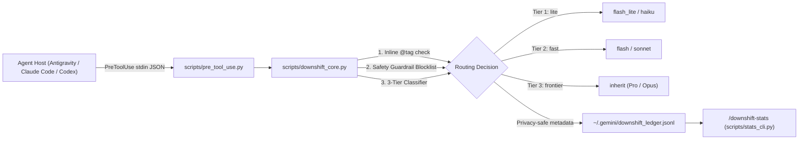

# Downshift — Multi-Host Agent Model Router

**Downshift** is a zero-dependency lifecycle-hook plugin for **Google Antigravity**, **Claude Code**, **OpenAI Codex**, and **Gemini CLI** that intercepts subagent spawns (`PreToolUse`) and initial prompt turns (`PreInvocation` / `UserPromptSubmit`) at runtime.

By default, subagent invocations inherit the parent frontier model (`Argon` / `Gemini Pro` / `Claude Opus`), burning expensive frontier quota and latency on mechanical file lookups, log scans, and `pytest`/`vitest` test runs. Downshift deterministically routes read-only exploration and verification loops to fast lightweight models (`flash_lite` / `flash` on Antigravity; `haiku` / `sonnet` on Claude Code) while enforcing hard safety guardrails so database migrations, concurrency/locking, security/auth, and stateful code mutations always stay on the frontier model.

---

## Architecture



---

## 3-Tier Routing Matrix

| Tier | Google Antigravity (`invoke_subagent`) | Claude Code (`Task` / `Agent`) | OpenAI Codex (`spawn_agent`) | Target Workloads |
| :--- | :--- | :--- | :--- | :--- |
| **Tier 1 (`lite`)** | `flash_lite` | `haiku` | `gpt-6-luna` (`low`) | Bounded file/symbol locating (`find file`, `where is`, `locate`), `git status`, `git branch`, directory listing, line counting |
| **Tier 2 (`fast`)** | `flash` | `sonnet` | `gpt-6.1-sol` (`medium`) | Multi-file codebase surveys (`research` / `Explore`), caller tracing, log scanning, and pure test/lint/build verification (`pytest`, `vitest`, `ruff`, `eslint`, `npm run build`) |
| **Tier 3 (`frontier`)** | `inherit` | `inherit` | `inherit` (`gpt-6-astra`, `high`) | Architecture design, stateful code mutations, database migrations, concurrency/locking, and security/auth |

### Hard Safety Guardrails (Never Downshifted)

Even if a subagent is spawned as `research` or `Explore`, Downshift **never** downgrades the model if the `Role` or `Prompt` matches high-risk engineering patterns (English or Vietnamese):

- **Database & Schema:** `alembic`, `migration`, `schema change`, `ddl`, `di trú dữ liệu`
- **Concurrency & Transactions:** `deadlock`, `race condition`, `advisory lock`, `for update`, `savepoint`, `rollback`, `khóa bảng`, `tranh chấp đồng thời`
- **Security & Auth:** `security`, `auth`, `authentication`, `authorization`, `permission`, `idor`, `cryptography`, `jwt`, `csrf`, `xss`, `secret`, `phân quyền`, `bảo mật`, `xác thực`
- **Production Incidents:** `production incident`, `outage`, `data corruption`, `billing account`, `lỗi mất tin nhắn`
- **Context-Aware Disambiguation & Complexity Promotion (`v0.2.0`):**
  - Pure read-only file/symbol location lookups (`Find the file where auth_service.py is defined`, `Locate 001_migration.py`) mask benign filename and `snake_case`/`camelCase` tokens so they route to Tier 1 (`lite`) without false-positive frontier locks, while genuine audits (`Audit auth_service.py for JWT token bypass`) remain on Tier 3 (`frontier`).
  - Simple lookup prompts exceeding `600` characters, referencing `>= 3` distinct file paths, or embedding fenced code blocks / stack tracebacks are automatically promoted from Tier 1 (`lite`) to Tier 2 (`fast`).

---

## 7-Stage v2 Subagent Orchestration & Effort Hand-Out Workflow

When a first-turn user prompt asks to draft an issue/spec, plan a feature, break down tasks across modules, map out an issue, compare against `main` / `develop`, or audit a repository/plugin (in English or Vietnamese, accented or unaccented), Downshift's `PreInvocation` / `UserPromptSubmit` hook (`PARALLEL_MAP_NUDGE_RE`, `reason="parallel_issue_map_or_comparison"`) guides the agent through a deterministic **7-stage v2 workflow**:

1. **Stage 1 — Triage & Fast-Path Gate (`<= 2` Known Files):** If a task touches `<= 2` known files, allocate **`0` subagents** and read, edit, and verify directly on the main agent.
2. **Stage 2 — Single-Turn Slice Decomposition:** Partition `3+`-file or multi-layer work into **`2–4` disjoint slices** in one turn (e.g., Backend Models/Migrations, API Routes/Services, Frontend UI/Hooks).
3. **Stage 3 — Deterministic Effort Hand-Out (`@low` / `@medium` / `@high`):** Assign explicit slice effort tags—`@low` (`< 3`-file / `< 600`-char read-only lookups -> Tier 1 `lite`, `0.04x`), `@medium` (`3+`-file module surveys, caller traces, log scans, or pure `pytest`/`vitest`/`ruff`/`eslint`/`npm run build` suites -> Tier 2 `fast`, `0.20x`), and `@high` (architecture audits, stateful multi-file mutations, `alembic` migrations, `FOR UPDATE`/advisory locks, security/auth -> Tier 3 `frontier`, `1.00x`).
4. **Stage 4 — Single-Turn Parallel Fan-Out:** Spawn **`2–4` subagents concurrently in a single turn** (`invoke_subagent` on Antigravity, `Task`/`Explore` on Claude Code, `spawn_agent` on OpenAI Codex). Shared `Workspace="inherit"` is strictly read-only; any parallel mutating `@high` workers require isolated `branch` / `share` worktrees.
5. **Stage 5 — Compact `<= 15`-Line 4-Field Hand-Back & Frontier Synthesis:** Each subagent returns at most **`15` lines** covering `Files & Lines`, `Exists vs. Missing`, `Boundary Contract` (exact API routes, `snake_case` vs `camelCase` payload keys, function/type signatures, DB/lock/auth invariants), and `Risks / Stale Assumptions`. The `frontier` main agent reconciles cross-layer boundary contracts and executes stateful code mutations (or reconciles isolated branches).
6. **Stage 6 — Adaptive Check & 2-Retry Circuit Breaker:** Focused `1–2`-file checks run directly on the main agent while heavy/noisy full test, lint, or build suites delegate to a `@medium` subagent; automatic fix-and-recheck cycles halt after **max `2` retries** (`2-retry circuit breaker`) and surface blockers to the user.
7. **Stage 7 — Clean Release:** Verify clean `git status` / `git diff`, update progress tracking where applicable, and report concise verification steps.

- **Anti-Storm & Safety Guardrails:** Preserves all 4 parallel fan-out guardrails—`2–4` subagent anti-storm cap (`<= 2` known files stay direct on the main agent; single `@low` lookups reserved for unknown file paths), read-only shared-workspace boundary, and mandatory Stage 5 cross-layer boundary contract reconciliation—with automatic Turn-1 suppression whenever built-in/custom `high_risk_keywords` or `@high` / `@frontier` override tags appear. At runtime, Downshift's `PreToolUse` dynamic burst-cap guardrail (`max_burst_subagents: 4` within `burst_window_seconds: 5` per `conversation_id`, overridable via `DOWNSHIFT_MAX_BURST`) atomically downgrades any 5th+ burst-eligible `fast` subagent to Tier 1 (`lite`, `reason="burst_cap_downgraded_to_lite"`) inside the cross-process ledger file lock while leaving safety guardrails and explicit `@tag` / `pinned_roles` overrides untouched.

---

## Inline `@tag` Overrides

Override Downshift's heuristics on any prompt or subagent call (universal effort hand-out tags `@high`, `@medium`, and `@low` work identically across Google Antigravity, Claude Code, and OpenAI Codex; when multiple tags appear, `@high` > `@medium` > `@low` wins, and high-risk safety guardrails always block lower-tier tags):

| Inline Tag | Effect |
| :--- | :--- |
| `@high`, `@pro`, `@opus`, `@frontier`, `@inherit` | Force **Tier 3 (`frontier` / `high` effort)** — never downshift (upgrades explicit lower-tier models to `inherit`) |
| `@medium`, `@flash`, `@sonnet`, `@fast`, `@downshift` | Route safe tasks to **Tier 2 (`fast` / `medium` effort)** (`flash` / `sonnet` / `gpt-6.1-sol`) — blocked by safety guardrails |
| `@low`, `@flash_lite`, `@lite`, `@haiku` | Route safe tasks to **Tier 1 (`lite` / `low` effort)** (`flash_lite` / `haiku` / `gpt-6-luna`) — blocked by safety guardrails |

---

## Operating Modes & Workspace Config (`.downshift.json`)

Control Downshift globally via `DOWNSHIFT_MODE` (`active` | `shadow` | `off`) or per-repository via a root `.downshift.json` file:

| Mode | Subagent Model Overwrite | Ledger Telemetry (`downshift_ledger.jsonl`) | `PreInvocation` Hints |
| :--- | :--- | :--- | :--- |
| `active` *(default)* | Enabled (`flash_lite` / `flash` / `haiku` / `sonnet`) | Recorded (`"mode": "active"`) | Enabled when `hints: true` |
| `shadow` *(dry-run)* | **Disabled** (`{"decision": "allow"}` only) | Recorded (`"mode": "shadow"`) | Suppressed |
| `off` | **Disabled** (`{"decision": "allow"}` only) | Not recorded | Suppressed |

Example `.downshift.json` at the workspace root:

```json
{
  "mode": "active",
  "hints": true,
  "high_risk_keywords": [
    "pawn contract",
    "interest calculation",
    "vietmoney production"
  ],
  "pinned_roles": {
    "Security Auditor": "frontier",
    "Log Reader": "lite"
  },
  "max_burst_subagents": 4,
  "burst_window_seconds": 5
}
```

- **Precedence:** Frontier `@high` / `@frontier` tag > explicit custom non-lower-tier model > `pinned_roles` mapped to `"frontier"` > built-in & custom `high_risk_keywords` safety guardrails > lower-tier `@medium` / `@low` inline tags (`@high` > `@medium` > `@low`) > explicit lower-tier model preservation > `pinned_roles` mapped to `"lite"` / `"fast"` > heuristic classification.
- **Portable Hook Launcher:** `hooks.json` and `hooks/claude-codex-hooks.json` invoke `./scripts/run_hook.cmd` (which delegates to `scripts/run_hook.sh` on POSIX), resolving the plugin's `scripts/` directory relative to the launcher location and automatically discovering `uv`, `python3`, `python`, or `py -3` with fail-open fallback.

---

## Multi-Host Installation

### 1. Google Antigravity
Clone or symlink Downshift into `.agents/plugins/downshift/`:
```bash
git clone https://github.com/P1e2003/Downshift.git .agents/plugins/downshift
```
Antigravity automatically discovers `plugin.json`, `hooks.json`, `rules/AGENTS.md`, and `skills/`.

### 2. Claude Code
Install via `.claude-plugin/plugin.json` (wires `hooks/claude-codex-hooks.json` for `UserPromptSubmit` and `PreToolUse` on `Task|Agent`):
```bash
claude plugin add /path/to/Downshift
```

### 3. OpenAI Codex
Install via `.codex-plugin/plugin.json` (wires `skills/` and `hooks/claude-codex-hooks.json`).

### 4. Gemini CLI
Install via `gemini-extension.json` (loads `rules/AGENTS.md` context rules).

---

## Live Telemetry & Skills (`/downshift-stats` & `/downshift-help`)

Every intercepted subagent routing decision is appended to `~/.gemini/downshift_ledger.jsonl` (or `DOWNSHIFT_LEDGER_PATH`) with bounded size auto-rotation (`DOWNSHIFT_MAX_LEDGER_BYTES`, default `5 MB`). **Raw prompt text is never written to disk** — only timestamps, subagent type, truncated role, integer `prompt_chars`, mode (`active` / `shadow`), tier, model, and routing reason code are recorded.

Run the scoreboard CLI directly or invoke `/downshift-stats` in chat:

```text
$ python ./scripts/stats_cli.py
  ╭─ ⚡ downshift stats ──────────────── live ledger · ~/.gemini/downshift_ledger.jsonl
  │
  │  Total subagents intercepted : 20  (18 active, 2 shadow · 14,520 prompt chars)
  │  Frontier calls saved        : 14 (70.0%)  · Est. credit cost saved: 58.4%
  │
  │  Credit cost     all-frontier  ████████████████████  100.0%
  │                  with router   ████████············   41.6%   ▼ 58.4% saved
  │
  │  ├── Routed to lite (Tier 1) :  5 (25.0%) ███······· [flash_lite/haiku/luna 0.04x]
  │  ├── Routed to fast (Tier 2) :  9 (45.0%) █████····· [flash/sonnet/sol · 0.20x]
  │  └── Kept on frontier        :  6 (30.0%) ███······· [guardrail/stateful · 1.00x]
  │
  │  Hosts & guardrails          : antigravity: 16, codex: 4 · 4 guardrail(s)
  │  Top routing reasons         : read_only_research_survey: 9, read_only_simple_looku…
  ╰─────────────────────────────────────────────────────────────────────────────────────
```

Flags:
- `python ./scripts/stats_cli.py --json` — Emit machine-readable JSON summary (`hosts`, `reasons`, `guardrail_count`, `tiers`, `models`)
- `python ./scripts/stats_cli.py --html <path.html>` — Write a theme-aware HTML scoreboard widget for Google Antigravity `generative_ui` (`<agent-embed>`)
- `python ./scripts/stats_cli.py --clean` — Non-destructively remove corrupted lines and synthetic empty (`prompt_chars == 0` and empty `role`) entries under an exclusive OS file lock
- `python ./scripts/stats_cli.py --reset` — Truncate/reset the local ledger under an exclusive OS file lock
- `python ./scripts/stats_cli.py --limit 50` — Aggregate the most recent `N` events

---

## Benchmark Results (`benchmarks/run_benchmark.py`)

Reproduce the 30-scenario benchmark across Antigravity and Claude Code payloads:

```bash
python ./benchmarks/run_benchmark.py
```

| Metric | Result |
| :--- | :--- |
| **Scenarios Evaluated** | `30` (`S01`–`S30`: English + Vietnamese lookups, surveys, test/lint runners, benign filenames, complexity promotion, workspace overrides, and high-risk guardrails) |
| **Routing Classification Accuracy** | **`100.0%` (`30/30`)** |
| **False Downgrades on High-Risk Tasks** | **`0` (`100%` safety recall)** |
| **Frontier Subagent Calls Saved** | **`70.0%` (`21/30` offloaded to Tier 1 / Tier 2)** |
| **In-Memory Classifier Latency (`p50`)** | **`< 50 µs` (`< 0.05 ms`)** |

---

## Development & Testing

Zero runtime dependencies (Python 3.10+ standard library only). Run the test and lint suites with `pytest` and `ruff`:

```bash
pytest -v
ruff format --check scripts/ tests/ benchmarks/
ruff check scripts/ tests/ benchmarks/
python benchmarks/run_benchmark.py
```

## License

MIT
