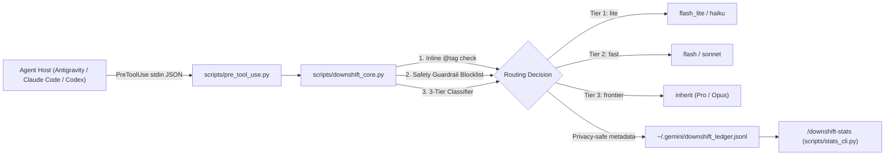

# Downshift — Multi-Host Agent Model Router

**Downshift** is a zero-dependency lifecycle-hook plugin for **Google Antigravity**, **Claude Code**, **OpenAI Codex**, and **Gemini CLI** that intercepts subagent spawns (`PreToolUse`) and initial prompt turns (`PreInvocation` / `UserPromptSubmit`) at runtime.

By default, subagent invocations inherit the parent frontier model (`Argon` / `Gemini Pro` / `Claude Opus`), burning expensive frontier quota and latency on mechanical file lookups, log scans, and `pytest`/`vitest` test runs. Downshift deterministically routes read-only exploration and verification loops to fast lightweight models (`flash_lite` / `flash` on Antigravity; `haiku` / `sonnet` on Claude Code) while enforcing hard safety guardrails so database migrations, concurrency/locking, security/auth, and stateful code mutations always stay on the frontier model.

---

## Architecture



---

## 3-Tier Routing Matrix

| Tier | Google Antigravity (`invoke_subagent`) | Claude Code (`Task` / `Agent`) | OpenAI Codex | Target Workloads |
| :--- | :--- | :--- | :--- | :--- |
| **Tier 1 (`lite`)** | `flash_lite` | `haiku` | `flash_lite` | Bounded file/symbol locating (`find file`, `where is`, `locate`), `git status`, `git branch`, directory listing, line counting |
| **Tier 2 (`fast`)** | `flash` | `sonnet` | `flash` | Multi-file codebase surveys (`research` / `Explore`), caller tracing, log scanning, and pure test/lint/build verification (`pytest`, `vitest`, `ruff`, `eslint`, `npm run build`) |
| **Tier 3 (`frontier`)** | `inherit` | `inherit` | `inherit` | Architecture design, stateful code mutations, database migrations, concurrency/locking, and security/auth |

### Hard Safety Guardrails (Never Downshifted)

Even if a subagent is spawned as `research` or `Explore`, Downshift **never** downgrades the model if the `Role` or `Prompt` matches high-risk engineering patterns:

- **Database & Schema:** `alembic`, `migration`, `schema change`, `ddl`
- **Concurrency & Transactions:** `deadlock`, `race condition`, `advisory lock`, `for update`, `savepoint`, `rollback`
- **Security & Auth:** `security`, `auth`, `authentication`, `authorization`, `permission`, `idor`, `cryptography`, `jwt`, `csrf`, `xss`, `secret`
- **Production Incidents:** `production incident`, `outage`, `data corruption`, `billing account`

---

## Inline `@tag` Overrides

Override Downshift's heuristics on any prompt or subagent call:

| Inline Tag | Effect |
| :--- | :--- |
| `@pro`, `@opus`, `@frontier`, `@inherit` | Force **Tier 3 (`frontier`)** — never downshift |
| `@flash`, `@sonnet`, `@fast`, `@downshift` | Force **Tier 2 (`fast`)** (`flash` / `sonnet`) |
| `@flash_lite`, `@lite`, `@haiku` | Force **Tier 1 (`lite`)** (`flash_lite` / `haiku`) |

---

## Multi-Host Installation

### 1. Google Antigravity
Clone or symlink Downshift into `.agents/plugins/downshift/`:
```bash
git clone https://github.com/P1e2003/Downshift.git .agents/plugins/downshift
```
Antigravity automatically discovers `plugin.json`, `hooks.json`, `rules/AGENTS.md`, and `skills/`.

### 2. Claude Code
Install via `.claude-plugin/plugin.json` (wires `hooks/claude-codex-hooks.json` for `UserPromptSubmit` and `PreToolUse` on `Task|Agent`):
```bash
claude plugin add /path/to/Downshift
```

### 3. OpenAI Codex
Install via `.codex-plugin/plugin.json` (wires `skills/` and `hooks/claude-codex-hooks.json`).

### 4. Gemini CLI
Install via `gemini-extension.json` (loads `rules/AGENTS.md` context rules).

---

## Live Telemetry & Skills (`/downshift-stats` & `/downshift-help`)

Every intercepted subagent routing decision is appended to `~/.gemini/downshift_ledger.jsonl` (or `DOWNSHIFT_LEDGER_PATH`). **Raw prompt text is never written to disk** — only timestamps, subagent type, truncated role, tier, model, and routing reason code are recorded.

Run the scoreboard CLI directly or invoke `/downshift-stats` in chat:

```text
$ python ./scripts/stats_cli.py
  downshift stats                   live ledger · ~/.gemini/downshift_ledger.jsonl

  Total subagents intercepted : 20
  Frontier calls saved        : 14 (70.0%)
  ├── Routed to lite (Tier 1) :  5 (25.0%)  [flash_lite / haiku]
  ├── Routed to fast (Tier 2) :  9 (45.0%)  [flash / sonnet]
  └── Kept on frontier        :  6 (30.0%)  [safety guardrail / stateful mutation]
```

Flags:
- `python ./scripts/stats_cli.py --json` — Emit machine-readable JSON summary
- `python ./scripts/stats_cli.py --reset` — Truncate/reset the local ledger
- `python ./scripts/stats_cli.py --limit 50` — Aggregate the most recent `N` events

---

## Benchmark Results (`benchmarks/run_benchmark.py`)

Reproduce the 20-scenario benchmark across Antigravity and Claude Code payloads:

```bash
python ./benchmarks/run_benchmark.py
```

| Metric | Result |
| :--- | :--- |
| **Scenarios Evaluated** | `20` (`5` simple lookup, `5` codebase/log survey, `4` test/lint runner, `6` high-risk/mutation) |
| **Routing Classification Accuracy** | **`100.0%` (`20/20`)** |
| **False Downgrades on High-Risk Tasks** | **`0` (`100%` safety recall)** |
| **Frontier Subagent Calls Saved** | **`70.0%` (`14/20` offloaded to Tier 1 / Tier 2)** |
| **In-Memory Classifier Latency (`p50`)** | **`~41 µs` (`0.04 ms`)** |

---

## Development & Testing

Zero runtime dependencies (Python 3.10+ standard library only). Run the test and lint suites with `pytest` and `ruff`:

```bash
pytest -v
ruff format --check scripts/ tests/ benchmarks/
ruff check scripts/ tests/ benchmarks/
python benchmarks/run_benchmark.py
```

## License

MIT
